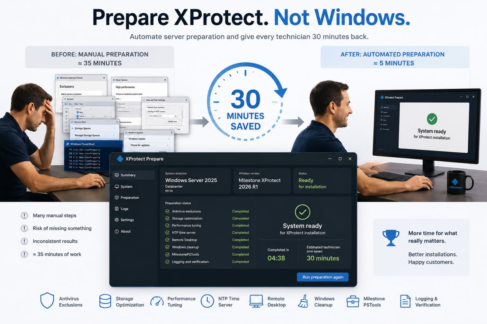
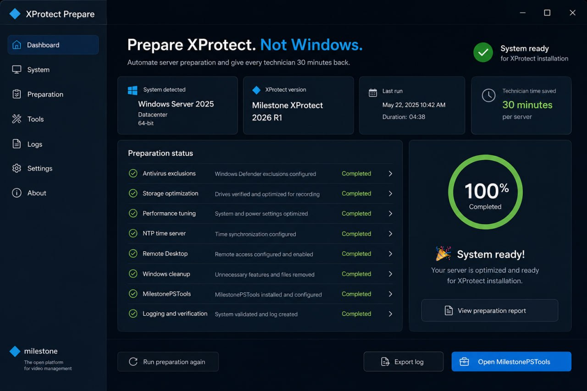

# XProtect Prepare Win



**Prepare XProtect. Not Windows.**

Hi! I'm Ulf, an ex Milestone Solution Engineer from Sweden. Over the years I have prepared more Windows machines for XProtect than I can count, and I kept seeing the same thing: the install itself is easy — it's *Windows* that gets in the way. Defender scanning the media database, drives formatted with the wrong allocation unit size, OneDrive nagging on a recording server, the clock drifting because nobody set up NTP properly.

I built this because I got tired of fixing the same fifteen things by hand on every new server. First it was a PowerShell script. Now it's this: a proper Windows app that any technician can run, that **checks everything first and only fixes what's actually wrong** — and tells you exactly what it did.

> **Not affiliated with Milestone Systems A/S.** This tool is not made by, with, or on behalf of Milestone Systems A/S, and it is not endorsed or supported by them. It is a personal project by an ex Milestone Solution Engineer, built to help fellow technicians. "Milestone" and "XProtect" are trademarks of Milestone Systems A/S.

## The idea: check first, fix only what's needed

Every single item follows the same model. Nothing is blindly applied. The tool inspects the current state, and either leaves it alone or corrects it — and reports which one happened:

| Status | Meaning |
|---|---|
| ✅ **Already done** | The setting was already correct. Nothing was touched. |
| 🔧 **Corrected now** | The setting was wrong and has been fixed. |

This makes the tool **idempotent** — you can re-run it any time. After a Windows feature update. After a colleague "helped" with the server. Or just before go-live, as a final verification pass. Running it twice in a row is always safe, and the second run should be a wall of "Already done".

## What it covers

- **Antivirus exclusions** — all XProtect paths and processes excluded from Defender, including VictoriaLogs and the Smart Client
- **Recording storage** — verifies 64 KB allocation unit size on media drives, turns off Windows indexing on them
- **Performance** — High Performance power plan, service tuning, `LargeSystemCache` for recording servers
- **Remote Desktop** — enabled and reachable
- **Bloatware cleanup** — removes OneDrive, Teams, new Outlook and other consumer clutter from a machine that should do one job. *Xbox components are kept deliberately — Windows screen recording depends on them.*
- **Privacy hardening** — Copilot off, Recall off, telemetry minimized
- **Time sync** — proper NTP time server configuration, including the `,0x9` flag fix that most guides miss
- **MilestonePSTools** — installed so the server is scriptable from day one
- **Optional extras** — OpenSSH server and SNMP, when you want them
- **Windows Update toggle** — pause updates during installation windows, resume after
- **Full audit trail** — everything is logged, and every registry value changed is backed up first, to `C:\Milestonecheck-ulfh`

## Screenshots



## Install

1. Download the latest `XProtectPrepareWin-x.y.z.msi` from [Releases](https://github.com/Frimurare/XProtect-Prepare-Win/releases).
2. Run the MSI — it installs to Program Files with a Start Menu shortcut.
3. Launch **XProtect Prepare Win** and approve the elevation prompt (admin rights are required — the tool asks via UAC).

## Silent mode / golden images

For scripted deployments, imaging pipelines and golden image preparation:

```
XProtectPrepareWin.exe --silent
XProtectPrepareWin.exe --silent --with-ssh
XProtectPrepareWin.exe --silent --drives D,E
XProtectPrepareWin.exe --silent --drives storage
```

| Flag | Effect |
|---|---|
| `--silent` | Run all checks and fixes without UI, then exit |
| `--with-ssh` | Also install and enable the OpenSSH server |
| `--drives D,E` | Treat these drive letters as recording storage |
| `--drives storage` | Auto-detect likely storage drives |

Logs and the registry backup land in `C:\Milestonecheck-ulfh` either way.

## Requirements

- Windows Server 2019 / 2022 / 2025, or Windows 10 / 11 (x64)
- Administrator rights
- **No .NET installation needed** — the app is fully self-contained

## Relationship to XProtect-Prepare (PowerShell)

This is the evolution of my original PowerShell tool, [XProtect-Prepare](https://github.com/Frimurare/XProtect-Prepare). Same field-proven best practice, same philosophy — but now as a re-runnable GUI application with clear per-item status, instead of a script. If you're already using the PowerShell version, this does everything it does and shows its work.

## License

MIT — see [LICENSE](LICENSE). Free to use, modify and share.

---

Built with ❤️ by **Ulf Holmström, Happy Problem Solver at Manvarg AB, Sweden**
